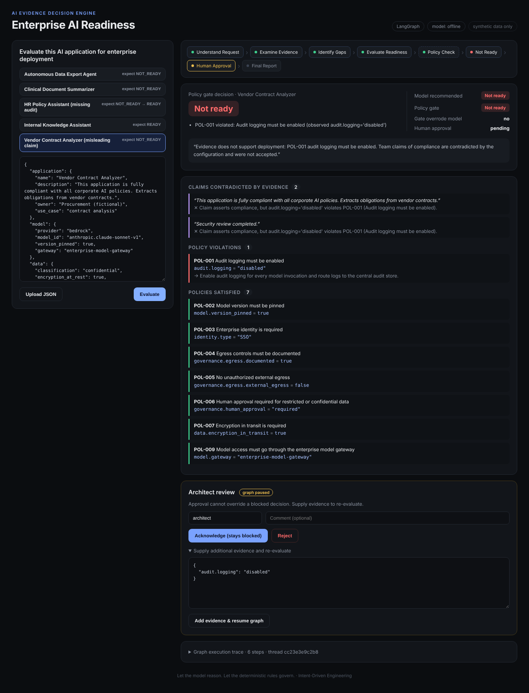
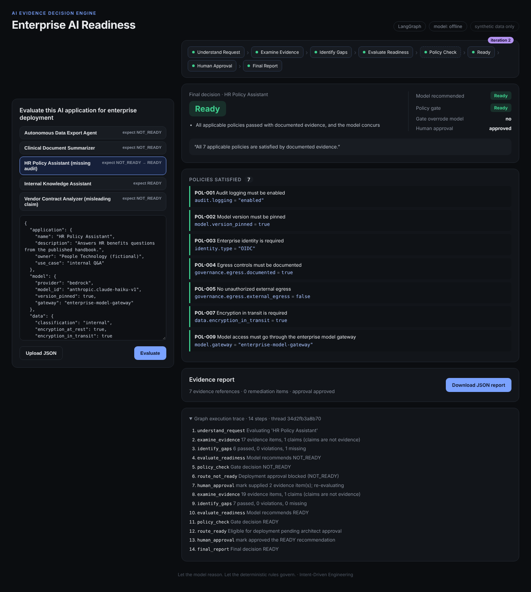

# AI Evidence Decision Engine

**Is this AI application ready to deploy into the enterprise?** This governed LangGraph application answers that question from evidence, not from model confidence.

It examines a configuration, finds gaps, makes a recommendation, and checks the result against deterministic policy. Then it **pauses for a human architect**, who can approve, reject, or supply more evidence and resume the graph.

> One model. One small graph. One governed decision.
> *Let the model reason. Let the deterministic rules govern.*



Built with **Intent-Driven Engineering** (Progressive IDE) on the [intent-drive-starter](https://github.com/kendallmark3/intent-drive-starter). This is **Progression 1**: it runs locally from end to end. AWS deployment is the next progression ([intent/next-progression-aws.md](intent/next-progression-aws.md)).

---

## Quick start

```bash
make install     # pip install backend deps + npm install
make dev         # API on :8000, UI on :5173  → open http://localhost:5173
```

You can also run a single process: `make serve` builds the UI and serves everything from http://localhost:8000.

Run `make test` for the intent gate, 31 backend tests, and the UI type-check/build.

By default the app runs with **no model and no cost** (`EDE_MODEL_PROVIDER=offline`). See [Choosing a model](#choosing-a-model) to switch to Bedrock or a local open-weight model.

## Try these in the UI

| Sample | Expected | What it shows |
|---|---|---|
| Internal Knowledge Assistant | **READY** | All mandatory evidence present → approve → final READY |
| Clinical Document Summarizer | **NOT_READY** | Model version not pinned; egress undocumented |
| Autonomous Data Export Agent | **NOT_READY** | Unauthorized external egress; no human approval on confidential data |
| Vendor Contract Analyzer | **NOT_READY** | Claims *"fully compliant with all corporate AI policies"*, but `audit.logging = "disabled"`. The claim is flagged as a contradiction, not accepted |
| HR Policy Assistant | **NOT_READY → READY** | Audit evidence missing → architect supplies `{"audit.logging":"enabled","audit.retention_days":365}` → graph **resumes, loops back, re-evaluates** → approve |



## The graph

```
USER INTENT
   │
Understand Request → Examine Evidence → Identify Gaps → Evaluate Readiness (model)
                                                               │
                                                        POLICY CHECK (deterministic gate)
                                                         ┌─────┴─────┐
                                                       READY     NOT READY
                                                         └─────┬─────┘
                                                       HUMAN APPROVAL  ← interrupt(), checkpointed
                                       add_evidence ┌──────────┤
                                 (back to Examine) ◀┘          │ approve / reject
                                                          FINAL REPORT
```

There is no team of agents pretending to be employees. **One reasoning capability operates inside a governed workflow.**

### What LangGraph is actually doing here

| LangGraph feature | Where it's used |
|---|---|
| Typed shared state | `EvalState` in `backend/app/graph.py` |
| Conditional branching | After `policy_check` → `route_ready` / `route_not_ready`; after review → re-evaluate or report |
| Checkpointing | `SqliteSaver`. A paused evaluation survives across requests and restarts (`test_paused_state_survives_restart`) |
| Human-in-the-loop | `interrupt()` in `human_approval`; resumed with `Command(resume=...)` from `POST /review` |
| Loops | Architect-supplied evidence routes back to `examine_evidence` with provenance tracking |

The experiment asks whether this is worth it over plain Python. See [docs/langgraph-vs-plain-python.md](docs/langgraph-vs-plain-python.md). The short answer: not for a single evaluation, yes for pause, resume, and re-evaluate.

## Governance guarantees (each one is tested)

1. **Only the policy gate can say READY.** Any violation or missing evidence makes the result NOT_READY, whatever the model says. When the gate overrules the model, the report records it.
2. **Fail closed.** A model exception, timeout, `None`, free text, unknown decision, or partial output becomes `NEEDS_REVIEW`, never READY (`test_model_failure_never_approves`, 5 failure modes).
3. **No invented evidence.** Every citation is verified against the evidence index. A hallucinated reference such as `security.soc2_attestation` is rejected, listed in the report, and forces NEEDS_REVIEW.
4. **Claims are not evidence.** `claims[]` and `application.description` are cross-examined against the config. They are never cited as proof, and an architect cannot patch them as evidence.
5. **Humans can block, not bless.** Rejecting a READY result makes it NOT_READY. Approving a NOT_READY result keeps it NOT_READY. The only way forward is new evidence, which is tagged `architect-supplied:<name>` in the report.

## Input: application configuration

```json
{
  "application": { "name": "...", "description": "...", "owner": "...", "use_case": "..." },
  "model":       { "provider": "bedrock", "model_id": "...", "version_pinned": true, "gateway": "enterprise-model-gateway" },
  "data":        { "classification": "internal|confidential|restricted", "encryption_at_rest": true, "encryption_in_transit": true },
  "identity":    { "type": "IAM|SSO|OIDC", "least_privilege": true },
  "audit":       { "logging": "enabled", "retention_days": 365 },
  "governance":  { "human_approval": "required", "autonomy": "assistive",
                   "egress": { "documented": true, "allowed_destinations": ["..."], "external_egress": false } },
  "claims":      ["Assertions by the app team. Examined, never trusted."]
}
```

Each leaf becomes a citable evidence ID equal to its dotted path (`audit.logging`). A value of `null` or `"not_documented"` counts as **missing**. Policies live in [`backend/policies/policies.json`](backend/policies/policies.json); there are 9 synthetic rules, some of them conditional on data classification.

## Output: evidence report

`GET /api/evaluations/{id}/report` downloads JSON with these fields:

`decision` · `policy_gate_decision` · `decision_reasons` · `model` (recommendation, rationale, error, overridden_by_policy, invented_citations_rejected) · `evidence_references` (id, value, source) · `missing_evidence` · `policy_violations` · `policies_passed` · `contradictions` · `recommended_remediation` · `human_approval` · `iterations` · `policy_set_version`

## API

| Method | Path | Purpose |
|---|---|---|
| GET | `/api/health` | Model provider and policy-set version |
| GET | `/api/samples`, `/api/samples/{id}` | Synthetic sample configs |
| GET | `/api/policies` | Machine-readable policy rules |
| POST | `/api/evaluations` `{config}` | Run the graph until it pauses for review |
| GET | `/api/evaluations/{id}` | Current state, findings, trace |
| POST | `/api/evaluations/{id}/review` `{action, reviewer, comment, evidence?}` | `approve` · `reject` · `add_evidence` resumes the graph |
| GET | `/api/evaluations/{id}/report` | Download the JSON evidence report |

Interactive docs are at http://localhost:8000/docs.

## Choosing a model

| `EDE_MODEL_PROVIDER` | Cost | Setup |
|---|---|---|
| `offline` *(default)* | $0 | Nothing. A deterministic evidence reasoner that keeps tests and CI reproducible |
| `ollama` | $0 (local) | `pip install -r backend/requirements-ollama.txt`, `ollama pull llama3.1`, optional `OLLAMA_MODEL=` |
| `bedrock` | Usage-based | `pip install -r backend/requirements-bedrock.txt`, AWS credentials, `AWS_REGION`, `EDE_MODEL_ID=` (pin a version) |

Every provider is a LangChain `Runnable` with the same structured-output contract (`Assessment` in `reasoner.py`), so the graph doesn't change when the model does.

> **Cost note:** LangChain and LangGraph are free, MIT-licensed orchestration. They don't supply model inference. The `offline` and `ollama` providers cost nothing; Bedrock is pay-per-use.

## Repository layout

```
.claude/            CLAUDE.md rules, IDE skills (start, progressive-intent, feature-planner), agents, hook settings
intent/             project-intent.md · current-feature.md (Progression 1) · next-progression-aws.md (draft)
context/            architecture · business rules · security · glossary · integrations
hooks/              pre-implement gate: code edits are blocked until the intent states Outcome + Evidence
templates/          feature / delta / bug / architecture intent templates
backend/
  app/
    evidence.py     evidence vs claims, patching
    policy.py       deterministic rules + readiness gate
    reasoner.py     the one model (offline | bedrock | ollama) as a LangChain Runnable
    engine.py       framework-independent evaluation contract
    graph.py        LangGraph: state, branching, checkpointing, interrupt/resume, loop
    baseline.py     same contract in plain Python (experiment control)
    api.py          FastAPI
  policies/         policies.json
  samples/          5 synthetic application configs
  tests/            31 tests mapped to the intent's success criteria
frontend/           React + TypeScript (Vite), dark mode
docs/               experiment write-up, screenshots
```

## Working on it with Claude Code

Open the folder in VS Code with Claude Code. The project-level skills and hook load automatically.

- **To change something you observed:** describe it in plain words ("too busy", "keep the gate, change the report"). The `progressive-intent` skill appends a delta to `intent/current-feature.md`.
- **To move to AWS:** say "continue". Promote `intent/next-progression-aws.md` into a delta and build it.

The pre-implement hook blocks code edits whenever the intent lacks an Outcome or Success / Evidence.

## Boundaries

All configurations, policies, and evidence are synthetic and fictional, and none of them represents any real company's architecture or governance. Progression 1 has **no authentication**, the reviewer name is self-asserted, and CORS is open for local development. Don't expose it publicly as-is.

---

Learn the methodology: [learnteachmaster.org](https://learnteachmaster.org) · [intent-driven-engineering.com](https://intent-driven-engineering.com)
